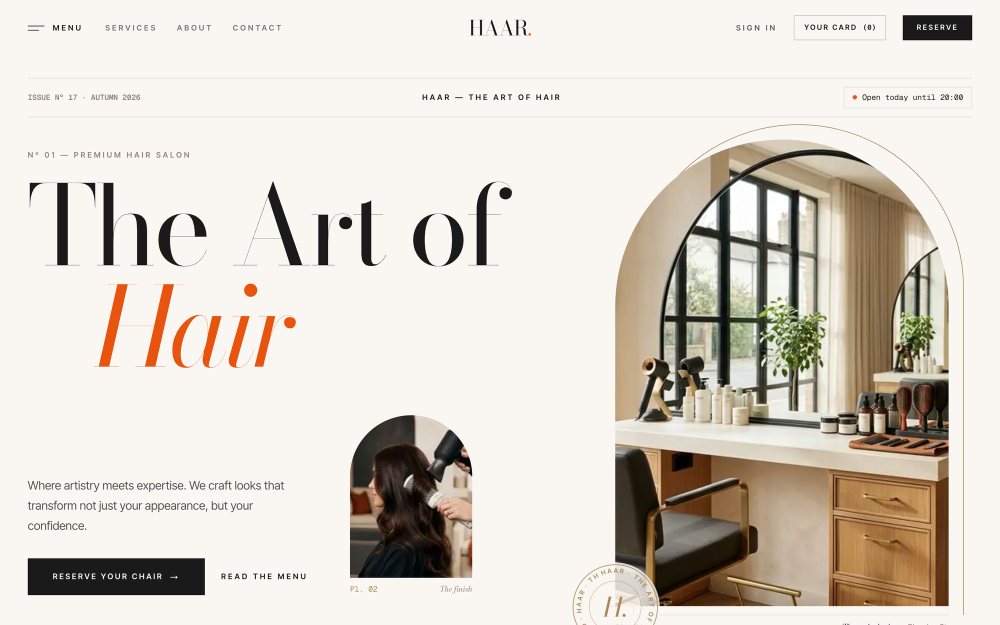
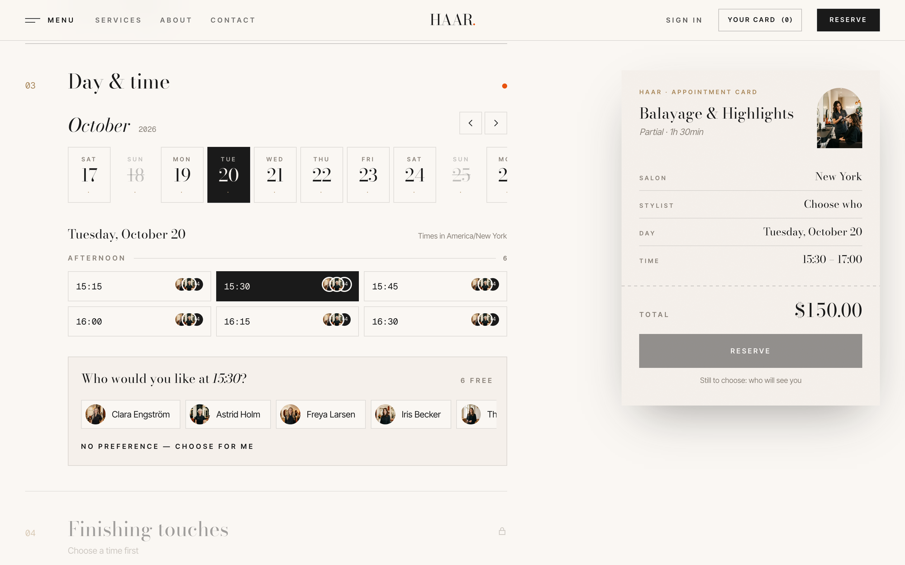
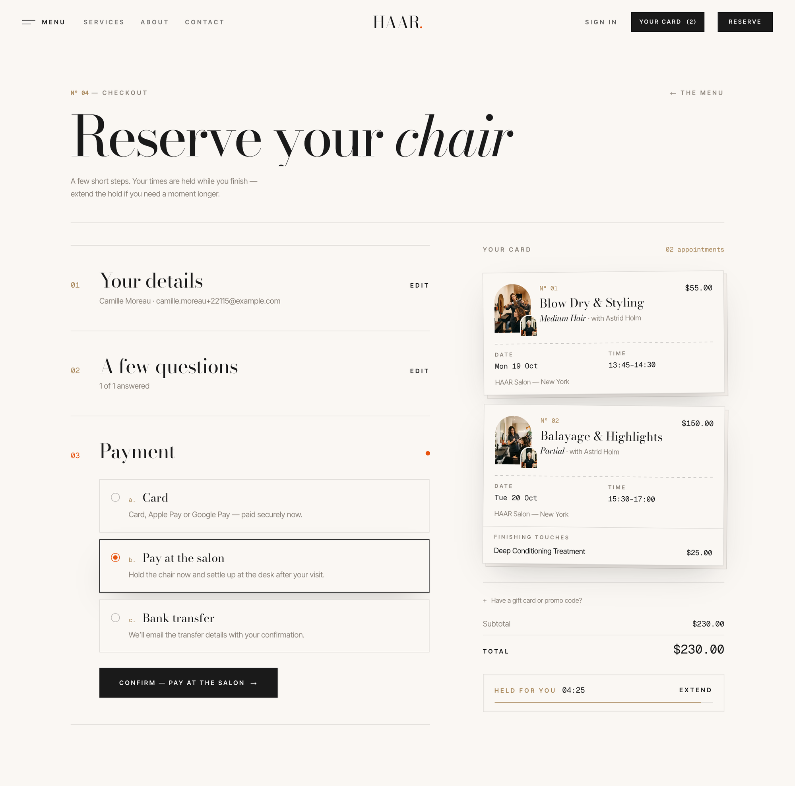
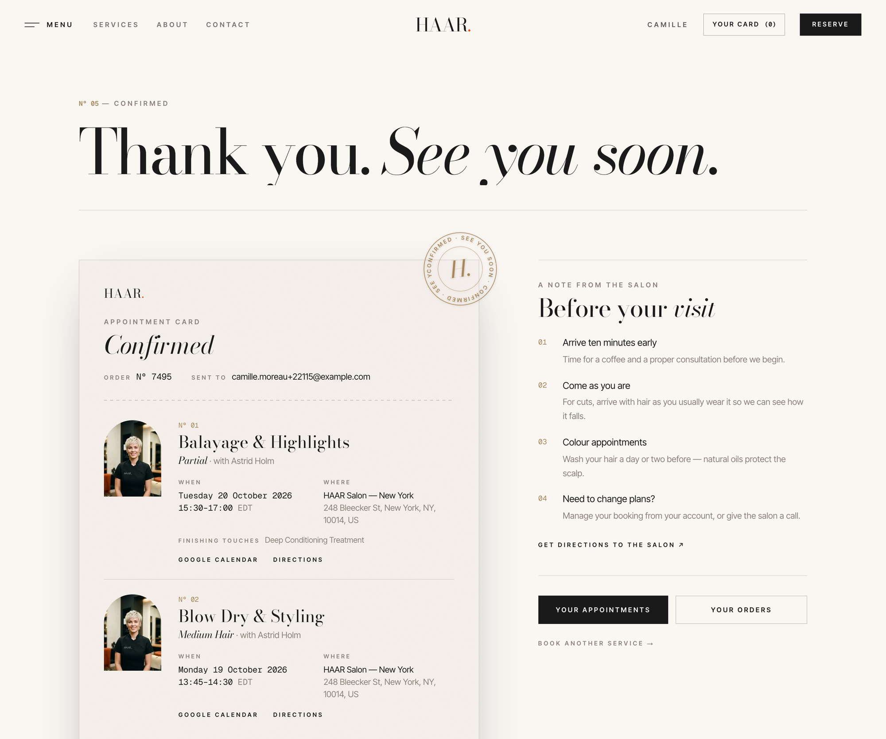
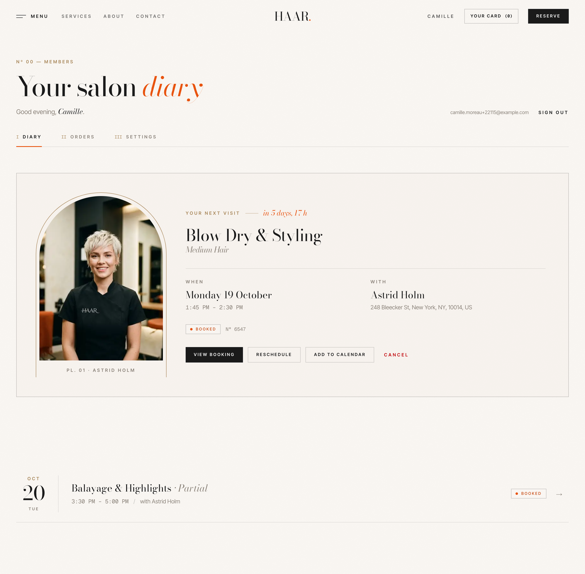
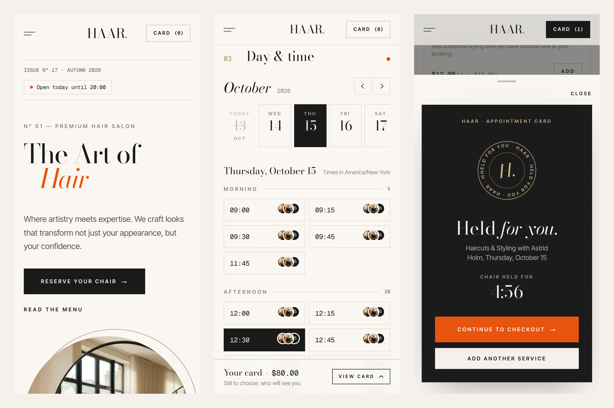

# HAAR Salon — Next.js Booking Template

A production-ready booking website for salons, spas, and service businesses. Built with **Next.js 15**, **Tailwind CSS v4**, and the **Opencals Storefront SDK**.

**[View Live Demo](https://template-haar.vercel.app/)**


---

## Get Started in 3 Steps

### 1. Create an Opencals account

Sign up at **[app.opencals.com](https://app.opencals.com)** and create a **Dev Store**. When prompted for a dataset, choose **"HAAR Salon"** — this seeds your store with sample services, staff, and locations so your template looks exactly like the demo.

### 2. Get your API key

Go to your **User Account Settings** in the Opencals dashboard and generate a **private storefront key** (`spk_`). The template calls the API from its server, so the key stays secret, and it forwards each visitor's IP (`nextBuyerIp` in `lib/opencals.ts`) so visitors get their own rate limits. If your server has fixed outgoing IPs you can restrict the key to them; on Vercel, leave the list empty. A public key (`sfk_`) also works, but then all visitors share your server's limits.

### 3. Deploy to Vercel

[](https://vercel.com/new/clone?repository-url=https%3A%2F%2Fgithub.com%2Fletsopencals%2Ftemplate-haar&env=OPENCALS_API_KEY,AUTH_SECRET&envDescription=API%20key%20from%20your%20Opencals%20dashboard%20and%20a%20random%20secret%20for%20auth&envLink=https%3A%2F%2Fgithub.com%2Fopencals%2Ftemplates%2Fblob%2Fmain%2Fhaar-salon-template%2FREADME.md%23environment-variables&project-name=haar-salon&repository-name=haar-salon)

During deployment, Vercel will ask you to set environment variables:

| Variable | Value |
|----------|-------|
| `OPENCALS_API_KEY` | Your private storefront key (starts with `spk_`) |
| `AUTH_SECRET` | Any random string — used for session encryption |

That's it. Once deployed, you'll have the same fully functional booking site as the [live demo](https://template-haar.vercel.app/).

---

## What's Included



### Editorial Atelier design
A magazine-style salon site: Bodoni Moda headlines, numbered sections, plate captions and arch-masked photography taken from the salon's arched mirror. Motion (line-masked reveals, arch wipes, a pinned "Ritual" sequence, Lenis smooth scroll) lives in `components/motion/` and switches off under `prefers-reduced-motion`.



### Consultation-card booking
One page instead of a wizard. Numbered sections (service, stylist, day & time, finishing touches) unlock in order, while a live appointment card writes itself in on the right. In "Any stylist" mode each time slot shows who is free, and you pick your stylist right there. Reserving flips the card to "Held for you" with the hold countdown. Closed days are greyed out, and `?date=&staff=&location=` deep links pre-fill the composer.

### Service variants and multiple locations
Variants show as "Hair length" choices (Short / Medium / Long), each with its own price, duration and staff. The location selector filters the menu, the stylists and the availability.



### Checkout
Your details → a few questions → payment, next to a stack of appointment cards with discounts, tax and a hold timer you can extend. Supports Stripe (card, Apple Pay, Google Pay), pay at the salon, bank transfer and free bookings.



### Confirmation
The card comes back stamped "Confirmed", with add-to-calendar (`.ics` + Google Calendar), directions and a "Before your visit" checklist.



### Customer accounts with passwordless sign-in
Sign in with a 6-digit email code or a password; links from booking emails sign the customer straight in. "Your salon diary" shows the next visit with a countdown, past and upcoming appointments, orders as receipts, and reschedule / cancel where the store allows it.



### Mobile-first
On phones the appointment card becomes a sticky "Your card · $80" bar that opens as a sheet, and checkout gets a sticky pay bar.

### SEO Ready
Per-page metadata, Open Graph/Twitter cards, JSON-LD structured data, robots.txt, and sitemap.xml — all configured out of the box.

---

## Tech Stack

| Category | Technology |
|----------|-----------|
| Framework | Next.js 15 (App Router) |
| Styling | Tailwind CSS v4 |
| Animations | Framer Motion |
| Forms | react-hook-form + Zod |
| Payments | Stripe Elements (Payment Element) |
| Auth | NextAuth.js v5 |
| Dates | moment-timezone |
| API | Opencals Storefront SDK |

---

## Local Development

```bash
git clone <repository-url>
cd haar-salon-template
npm install
cp .env.example .env
```

Edit `.env` with your values:

```
OPENCALS_API_KEY=spk_your_key_here
AUTH_SECRET=change_me_to_a_random_string
```

```bash
npm run dev
```

Open [http://localhost:3000](http://localhost:3000).

---

## Customization

### Branding & Content

All salon-specific copy is centralized in **`lib/site-config.ts`**:

- Salon name, tagline, and logo
- Homepage hero text, CTA sections, and testimonials
- About page story, team members, and values
- Contact information (address, phone, email, hours)
- Footer links and social media

Edit this single file to rebrand the entire template.

### Theme Colors

Colors are defined as CSS custom properties in **`app/globals.css`**:

```css
@theme {
  --color-accent: #E8530E;        /* Primary brand color */
  --color-cream: #F5F0EB;         /* Light background */
  --color-charcoal: #1A1A1A;      /* Dark text/backgrounds */
  --color-warm-gray: #8A8279;     /* Secondary text */
  --font-display: 'Playfair Display', Georgia, serif;
  --font-body: 'Inter', system-ui, sans-serif;
}
```

### Adding Pages

Follow the existing pattern:
1. Create `app/your-page/page.tsx` (component)
2. Create `app/your-page/layout.tsx` (metadata)
3. Add to `navLinks` in `components/layout/header.tsx`

---

## Project Structure

```
app/
  page.tsx                    # Homepage
  services/page.tsx           # Service listing with location filter
  booking/[slug]/page.tsx     # Booking page (date/time/staff picker)
  checkout/page.tsx           # Multi-step checkout
  thank-you/page.tsx          # Post-checkout confirmation
  about/page.tsx              # About page (story, values, team)
  contact/page.tsx            # Contact form + info
  account/                    # Customer dashboard (appointments, orders, settings)
  auth/                       # Sign in, sign up, forgot/reset password
  api/                        # API routes (products, availability, booking, checkout, auth)

components/
  layout/header.tsx           # Fixed header with nav, auth, cart
  layout/footer.tsx           # Footer with location/timezone selectors
  home/                       # Homepage sections (hero, CTA, gallery, testimonials)
  booking/                    # Date picker, time slots, staff/location selectors
  cart/cart-drawer.tsx         # Slide-out cart drawer
  checkout/                   # Step components (customer, questions, payment, summary)
  ui/                         # Shared UI components (form, staff-avatars)

contexts/
  cart-context.tsx             # Cart state + localStorage persistence
  checkout-context.tsx         # Checkout multi-step state machine
  location-context.tsx         # Global location selector
  timezone-context.tsx         # User timezone detection + override

hooks/
  use-api-request.ts           # Generic fetch wrapper with loading/error
  use-form-submit.ts           # Form submission with API call
  use-date-formatter.ts        # Timezone-aware date/time formatting

lib/
  site-config.ts               # All branding, copy, and content in one file
  opencals.ts                  # SDK client setup
  schemas.ts                   # Zod validation schemas
  format.ts                    # Price, duration, image formatting
  auth.ts                      # NextAuth configuration
```

## Environment Variables

| Variable | Required | Description |
|----------|----------|-------------|
| `OPENCALS_API_KEY` | Yes | Private storefront key (`spk_`) from your Opencals dashboard |
| `AUTH_SECRET` | Yes | Random string for NextAuth session encryption |
| `OPENCALS_API_URL` | No | Override API base URL (defaults to production) |

## Other Templates

HAAR is one of the open-source booking templates built on the Opencals Storefront SDK. Same backend, different design and vertical:

- **[Clear Care](https://github.com/letsopencals/template-clarity)** — a medical clinic template with department-first booking. [Live demo](https://template-clarity.vercel.app)
- **[Frisor](https://github.com/letsopencals/template-frisor)** — a modern barbershop template with a dark editorial palette. [Live demo](https://template-frisor-sage.vercel.app)
- **[VOLT](https://github.com/letsopencals/template-volt)** — a multi-club padel & squash template with a live hall map and court grid. [Live demo](https://template-volt.vercel.app)
- **[NOIR Drive](https://github.com/letsopencals/template-noir)** — a luxury car-rental template (Dubai) with multi-day booking by the day and chauffeur packages. [Live demo](https://template-noir.vercel.app)
- **[Fluently](https://github.com/letsopencals/template-fluently)** — a language-school template (New York) with group classes, live seats, private lessons and online lessons. [Live demo](https://template-fluently.vercel.app)
- **[Bali Villa Rentals](https://github.com/letsopencals/template-bali-villas)** — a villa-rental template (Bali, demo brand Lumbung Sidemen) with nightly stays and fixed check-in and check-out. [Live demo](https://template-bali-villas.vercel.app)
- **[Tensile](https://github.com/letsopencals/template-reformer)** — a reformer Pilates studio template (Berlin) with a multi-studio class timetable, beds left, privates and workshops. [Live demo](https://template-reformer.vercel.app)
- **[Alba Dental](https://github.com/letsopencals/template-alba)** — a dental group template (London) with five studios, a Smile Check on a tooth chart, a chair-time booking planner and a cut-paper kids site. [Live demo](https://template-alba.vercel.app)
- **[Gable](https://github.com/letsopencals/template-gable)** — a coworking template (Dublin, Cork and Galway) with six houses, desks, meeting rooms, booths and studios planned on one day sheet, with extras suggested in the gaps. [Live demo](https://template-gable.vercel.app)

See all templates and the Storefront API at **[opencals.com/developers](https://opencals.com/developers)**.

## Build with AI

Prefer to let an AI agent do the heavy lifting? Install the **[Opencals Agent Skills](https://github.com/letsopencals/skills)** in Claude Code, Cursor, Codex or Gemini CLI:

- **`opencals-build-booking-site`** — scaffold, wire and deploy a template like this one
- **`opencals-storefront-api`** — ground-truth reference for the Opencals API & SDK

Docs: **[opencals.com/docs → AI Agents](https://opencals.com/docs/ai-agents/overview)**.

## License

MIT
